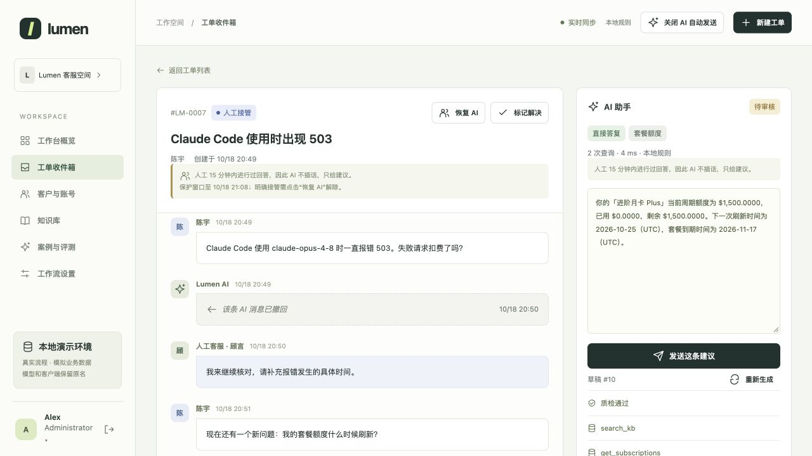

<div align="center">

# Lumen Support Desk

**An AI support demo that checks business evidence, answers routine questions and hands decisions to staff.**

[](README.md)
[](README.zh-CN.md)

[](pyproject.toml)
[](docs/architecture.md)
[](docs/operations.md#live-updates)
[](docs/verification.md)
[](docs/architecture.md#evidence-and-actions)

[Quick start](#quick-start) · [Real model](#connect-a-real-model) · [Evaluation](#evaluation) · [Documentation](docs/README.md)

</div>

A personal portfolio project with a customer website, support workbench, admin console and local business database. **The entire website runs without a model API.** Optional model access adds triage, answer composition and review.

Accounts, policies, transactions and knowledge are synthetic. Model and client names are retained. No real payments, refunds or external customer systems are connected. The interface and sample conversations are in Simplified Chinese; this guide is in English.

## Product demo



*Local demo: staff can inspect evidence, send a suggestion or retract an AI reply. This historical screenshot shows the collaboration workflow, not proof of a live model call.*

## What it solves

| Support problem | Product behavior |
|---|---|
| Customers wait for routine answers | Automatic replies by default, with visible generation status and live updates |
| Generic answers miss account details | Retrieve knowledge and query scoped account, quota, request and order data |
| Follow-up questions lose context | Carry recent public customer, AI and staff messages; track topic switches and refresh business facts |
| AI interrupts a staff conversation | Human priority for 15 minutes; unanswered follow-ups produce private suggestions after 1 minute |
| Staff need control over mistakes and actions | Reply/retract controls, admin-only account and balance changes, explicit approval for protected operations |

These are implemented workflows. Reduced handling time, support cost and commercial impact remain outcomes to measure in a real deployment.

## Quick start

Extract the ZIP and open a terminal **inside the folder containing this README**. Requires **Python 3.11+**; the website needs no pip packages, npm or separate database server.

```bash
python3 scripts/start_demo.py --provider local
```

The launcher creates six demo accounts and opens the website. Use the address printed in the terminal, normally [http://127.0.0.1:8080](http://127.0.0.1:8080). It tries subsequent ports if 8080 is occupied. Keep the terminal open; **Ctrl+C** stops the server.

On Windows, use `py -3` instead of `python3`. On macOS, `start-demo.command` also launches local mode. No API key, internet connection or `.env` file is needed.

### Demo accounts

All initial passwords: **`Demo123!`**.

| Role | Email | Access / sample scenario |
|---|---|---|
| Administrator | `admin@lumen.test` | Accounts, plans, balances, tickets and global AI switch |
| Support | `support1@lumen.test`, `support2@lumen.test` | Replies, private suggestions and AI message retraction |
| Customer | `alice@lumen.test` | Small negative balance and failed requests |
| Customer | `ben@lumen.test` | Exhausted quota and refund requests |
| Customer | `cora@lumen.test` | Client configuration and invoices |

Staff and admins can switch to their personal view through the bottom-left avatar. Support accounts cannot change balances, plans or the global AI switch.

### Try the workflow

1. Sign in as a customer, simulate a request in the model directory, then create a ticket from that request.
2. Stay on the ticket page: routine replies appear automatically. Cases requiring approval or human judgment go to staff.
3. Sign in as support in a **different browser or independent private session**. Send a human reply, then ask a follow-up as the customer.
4. After 1 minute without another staff reply, inspect the private suggestion. Send it or retract an earlier AI reply; the customer view updates automatically.

Ordinary tabs share a login session. The model directory simulates business usage; it is separate from the model generating support replies.

## Connect a real model

Run this command and **enter the settings when the terminal asks**. No configuration file is required.

```bash
python3 scripts/start_demo.py --provider openai
```

| Setting | Enter |
|---|---|
| Base URL | Your provider's API prefix, for example `https://your-service.example/v1` |
| API key | Paste and press Enter; hidden input shows no characters |
| Model ID | The exact model ID available to your provider account |
| API type | `1` = Chat Completions; `2` = Responses; Enter defaults to `2` |

The application adds `/chat/completions` or `/responses`; do not include that suffix in the Base URL. The service must support strict JSON Schema output. Startup verifies triage, composition and review with **three short API requests**, which may incur charges.

Interactive settings stay only in the running Python process. They are not saved to files, the database or the parent shell. A later launch asks again unless you explicitly supplied the corresponding process environment variables. Actual model requests send authentication and scoped conversation/evidence data to **your chosen endpoint**.

The staff panel shows model names, call stages, timings and any fallback. “Provider selected” alone does not prove a successful reply. See [connection troubleshooting and configuration details](docs/operations.md#model-connection).

## Evaluation

| Evidence | Recorded result | Meaning |
|---|---|---|
| Local software suite, v0.5.7 | **225 passed** | Automated checks; API behavior is mocked |
| Portal workflow regression | **29/29 scenarios** | Routing, tools and required facts on synthetic cases |
| Legacy RAG regression | **48/48 scenarios, 63/63 turns** | Compatibility with the earlier standalone demo |
| Retrieval comparison, v0.5.6 | **20 development + 10 holdout queries** | BM25, character n-grams and hybrid under the same filtering rules |

All three retrieval methods tied **after filtering**: development Recall@4 **67.65%**, holdout Recall@4 **68.75%**. Raw rankings differed; coverage filtering removed relevant evidence. The existing hybrid remains in use. Labels are AI-assisted and await owner review; these figures are not answer accuracy or production resolution rates.

[Results, limitations and commands](docs/evaluation.md) · [Retrieval comparison](docs/retrieval-comparison.md) · [Release verification](docs/verification.md)

## Project layout

```text
support_agent/desk/   Current support workflow, business data and UI
support_agent/       Shared retrieval and legacy RAG entrypoints
scripts/             Launch, evaluation, import and release tools
tests/               Automated checks
docs/                Guides, images and historical records
evals/               Frozen datasets, results and release evidence
knowledge/           Guidance for private source preparation
runtime/             Created on launch; excluded from releases
```

The default database is `runtime/lumen_desk.db`. A newly extracted release creates its own demo data; existing project databases stay in their original folders. [Persistence and optional Docker setup](docs/operations.md#data-and-launch-options).

**Next work:** review retrieval labels, improve coverage filtering using development data, and summarize measured model usage and cost. This version makes no measured cost-saving claim and performs no model fine-tuning.

[Chinese guide](README.zh-CN.md) · [Documentation index](docs/README.md) · [Earlier standalone RAG](docs/legacy/README.md)

