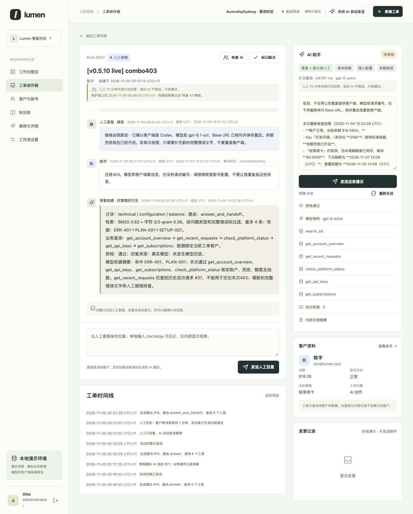

<div align="center">

# Lumen Support Desk

**An AI support demo that checks business evidence, answers routine questions and hands decisions to staff.**

[](README.md)
[](README.zh-CN.md)

[](pyproject.toml)
[](docs/architecture.md)
[](docs/operations.md#live-updates)
[](docs/verification.md)
[](docs/architecture.md#evidence-and-actions)

[Quick start](#quick-start) · [Real model](#connect-a-real-model) · [Evaluation](#evaluation) · [Documentation](docs/README.md)

</div>

A personal portfolio project with a customer website, support workbench, admin console and local business database. **The entire website runs without a model API.** Optional model access adds triage, answer composition and review.

Accounts, policies, transactions and knowledge are synthetic. Model and client names are retained. No real payments, refunds or external customer systems are connected. The interface and sample conversations are in Simplified Chinese; this guide is in English.

## Product demo



*v0.5.10 real-model acceptance: the admin sees combined knowledge and query evidence before a private suggestion. Support and customer views omit the technical explanation.*

## What it solves

| Support problem | Product behavior |
|---|---|
| Customers wait for routine answers | Automatic replies by default, with visible generation status and live updates |
| Generic answers miss account details | Retrieve knowledge and query scoped account, quota, request and order data |
| Request IDs and local times cannot be matched | Match within the customer account by request ID first; convert event time zones in code |
| Demo usage does not change account state | Scheduled quota refresh, simulated quota/balance debits and visible billing sources |
| Follow-up questions lose context | Carry recent public customer, AI and staff messages; track topic switches and refresh business facts |
| AI interrupts a staff conversation | Human priority for 15 minutes; unanswered follow-ups produce private suggestions after 1 minute |
| Staff need control over mistakes and actions | Reply/retract controls; rule-checked automatic balance corrections, staff `/recharge` and invoice edits; admin-only refunds, account management and arbitrary financial changes |

These are implemented workflows. Reduced handling time, support cost and commercial impact remain outcomes to measure in a real deployment.

## Quick start

Extract the ZIP and open a terminal **inside the folder containing this README**. Requires **Python 3.11+**; the website needs no pip packages, npm or separate database server.

```bash
python3 scripts/start_demo.py --provider local
```

The launcher creates six demo accounts and opens the website. Use the address printed in the terminal, normally [http://127.0.0.1:8080](http://127.0.0.1:8080). It tries subsequent ports if 8080 is occupied. Keep the terminal open; **Ctrl+C** stops the server.

On Windows, use `py -3` instead of `python3`. On macOS, `start-demo.command` also launches local mode. No API key, internet connection or `.env` file is needed.

### Demo accounts

All initial passwords: **`Demo123!`**.

| Role | Email | Access / sample scenario |
|---|---|---|
| Administrator | `admin@lumen.test` | Accounts, plans, balances, tickets and global AI switch |
| Support | `support1@lumen.test`, `support2@lumen.test` | Replies, retractions, ticket-scoped `/recharge` and invoice edits |
| Customer | `alice@lumen.test` | Small negative balance and failed requests |
| Customer | `ben@lumen.test` | Exhausted quota and refund requests |
| Customer | `cora@lumen.test` | Client configuration and invoices |

Staff and admins can switch views through the bottom-left avatar. AI can clear eligible negative balances. Support/admins can enter `/recharge` in a ticket to override eligibility; the result is staff-only. Support can also edit invoice titles and reissue without changing the amount. Arbitrary balance adjustments, plans, refund approval, invoice amount changes and the global AI switch require an admin.

### Try the workflow

1. Sign in as a customer, simulate a request in the model directory, then create a ticket from that request.
2. Stay on the ticket page: routine replies appear automatically. Cases requiring approval or human judgment go to staff.
3. Sign in as support in a **different browser or independent private session**. Send a human reply, then ask a follow-up as the customer.
4. After 1 minute without another staff reply, inspect the private suggestion. Send it or retract an earlier AI reply; the customer view updates automatically.

Ordinary tabs share a login session. The model directory simulates business usage; it is separate from the model generating support replies.

## Connect a real model

Run this command and **enter the settings when the terminal asks**. No configuration file is required.

```bash
python3 scripts/start_demo.py --provider openai
```

| Setting | Enter |
|---|---|
| Base URL | Your provider's API prefix, for example `https://your-service.example/v1` |
| API key | Paste and press Enter; hidden input shows no characters |
| Model ID | The exact model ID available to your provider account |
| API type | `1` = Chat Completions; `2` = Responses; Enter defaults to `2` |

The application adds `/chat/completions` or `/responses`; do not include that suffix in the Base URL. The service must support strict JSON Schema output. Startup verifies triage, composition and review with **three short API requests**, which may incur charges.

Interactive settings stay only in the running Python process. They are not saved to files, the database or the parent shell. A later launch asks again unless you explicitly supplied the corresponding process environment variables. Actual model requests send authentication and scoped conversation/evidence data to **your chosen endpoint**.

Final replies retain their model/source label. Only admins see evidence summaries, knowledge IDs, tool traces, call timings and fallback details. “Provider selected” alone does not prove a successful reply. See [connection troubleshooting and configuration details](docs/operations.md#model-connection).

## Evaluation

| Evidence in v0.5.10 | Result | Scope |
|---|---|---|
| Software checks | **292 passed** | Includes mocked model calls and role isolation |
| Portal workflow | **29/29 scenarios** | Synthetic business regression |
| Real model | **12 turns, 34 API calls** | Includes pre-fix investigations and corrected reruns; not a first-pass success rate |
| Legacy RAG, historical v0.5.9 | **48/48 scenarios, 63/63 turns** | Earlier standalone workflow; not rerun for this release |
| Owner-reviewed labels | **30/30 approved** | 20 development + 10 historical holdout questions |
| Updated retrieval | **25/25 answerable questions fully covered; 0/3 false retrievals on missing knowledge** | Known-question regression; not blind validation or answer accuracy |

The hybrid scorer remains BM25 0.62 + character n-gram 0.38. This release fixes Chinese-adjacent error codes, missing plan-policy dependencies and a monetary check that incorrectly triggered fallback. Live reruns verified the fixes using `gpt-6-astra` through Chat Completions. Historical v0.5.6 results remain unchanged.

Admins now get a short evidence receipt before the final reply, plus reported token usage, retries and estimated cost at self-configured rates. The receipt shares the answer-generation call; no extra model request is added. Missing usage or prices remain unknown.

[Real-model findings](docs/live-model-acceptance.md) · [Evaluation and reproduction](docs/evaluation.md) · [Release verification](docs/verification.md) · [Evidence and cost guide](docs/admin-evidence.md)

## Project layout

```text
support_agent/desk/   Current support workflow, business data and UI
support_agent/       Shared retrieval and legacy RAG entrypoints
scripts/             Launch, evaluation, import and release tools
tests/               Automated checks
docs/                Guides, images and historical records
evals/               Frozen datasets, results and release evidence
knowledge/           Guidance for private source preparation
runtime/             Created on launch; excluded from releases
```

The default database is `runtime/lumen_desk.db`. A newly extracted release creates its own demo data; existing project databases stay in their original folders. [Persistence and optional Docker setup](docs/operations.md#data-and-launch-options).

**Next measurement:** unseen retrieval questions and a representative business pilot beyond these known synthetic cases. No measured labor savings, revenue improvement or model fine-tuning is claimed.

[Approved business rules](docs/business-rules.md) · [Chinese guide](README.zh-CN.md) · [Documentation index](docs/README.md) · [Earlier standalone RAG](docs/legacy/README.md)

