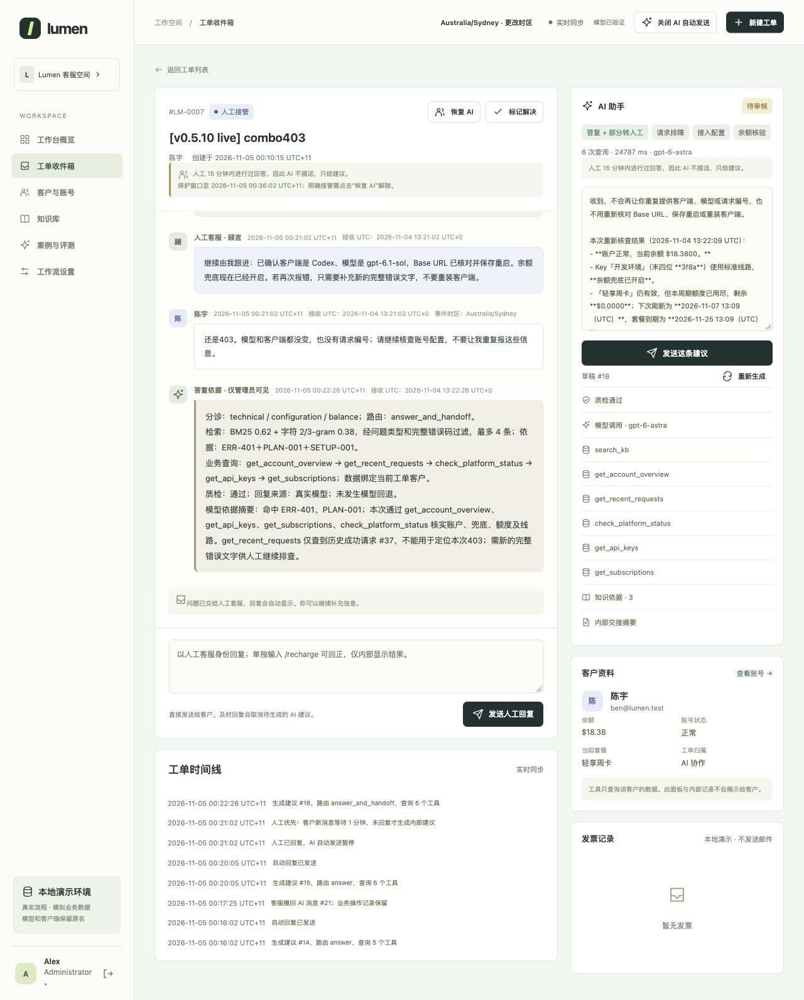

<div align="center">

# Lumen Support Desk

**基于业务证据回答问题，支持自动回复与人工协作的 AI 客服演示项目。**

[](README.md)
[](README.zh-CN.md)

[](pyproject.toml)
[](docs/architecture.zh-CN.md)
[](docs/operations.zh-CN.md)
[](docs/verification.zh-CN.md)
[](docs/architecture.zh-CN.md)

[快速开始](#快速开始) · [接入真实模型](#接入真实模型) · [评测结果](#评测结果) · [文档索引](docs/README.zh-CN.md)

</div>

个人作品项目，包含客户网站、客服工作台、管理员后台和本地业务数据库。**整个网站无需模型 API 即可独立运行**；接入真实模型后，由模型参与分诊、回复措辞和质检。

账号、规则、交易和知识均为合成演示数据，保留模型与客户端名称。项目未连接真实支付、退款或外部客户系统，不会自动上传原始客服导出。

## 产品演示



*v0.5.10 真实模型实测：管理员先看到组合知识与查询依据，再看到内部建议；客服和客户不显示这段技术说明。*

## 解决什么问题

| 客服场景 | 已实现能力 |
|---|---|
| 常见问题等待人工回复 | 默认自动回复，生成状态可见，客户无需手动刷新 |
| 通用答案不符合用户实际情况 | 检索知识，并查询该用户的账户、额度、请求和订单 |
| 无法对应请求编号与本地时间 | 优先在本账户内按编号精确定位，由程序换算事件时区 |
| 模拟请求与账户状态脱节 | 定时刷新额度、模拟扣额度或余额，展示每笔计费来源 |
| 连续追问或换话题导致上下文混乱 | 保留近期客户、AI、人工公开对话，识别主题切换并重新查询业务状态 |
| 人工接待时 AI 插话 | 人工回复后优先 15 分钟；客户追问 1 分钟无人回复才生成内部建议 |
| 客服需要纠错与操作权限 | 回复、撤回按钮；AI 按条件自动回正，客服可用 `/recharge` 及修改发票抬头，退款、账号与任意财务调整由管理员处理 |

以上是已实现的业务流程。处理时长、客服成本与商业收益仍需上线后用真实业务数据衡量。

## 快速开始

解压 ZIP，在**含有本 README 的项目文件夹**中打开终端。需要 **Python 3.11+**；运行网站无需安装 pip 包、npm 或数据库服务。

```bash
python3 scripts/start_demo.py --provider local
```

程序会创建 6 个演示账号并打开网站，通常为 [http://127.0.0.1:8080](http://127.0.0.1:8080)。若端口占用会尝试后续端口，**以终端显示的地址为准**。保持终端运行，按 **Ctrl+C** 停止。

Windows 将 `python3` 换成 `py -3`。macOS 也可双击 `start-demo.command`。本地模式不需要 API Key、网络或 `.env` 文件。

### 演示账号

所有初始密码均为 **`Demo123!`**。

| 角色 | 邮箱 | 权限 / 示例场景 |
|---|---|---|
| 管理员 | `admin@lumen.test` | 账号、套餐、余额、工单和全局 AI 开关 |
| 客服 | `support1@lumen.test`、`support2@lumen.test` | 回复、撤回、工单内 `/recharge` 与发票修改 |
| 客户 | `alice@lumen.test` | 小额负余额、请求失败 |
| 客户 | `ben@lumen.test` | 套餐额度耗尽、退款诉求 |
| 客户 | `cora@lumen.test` | 客户端配置、发票 |

客服和管理员可点击左下角头像切换个人页面与工作台。AI 核验条件后可自动回正负余额；客服和管理员可在工单输入 `/recharge` 跳过资格条件，结果仅内部可见。客服也可修改发票抬头及不改金额地重开。任意余额调整、套餐、退款审批、发票金额变更及全局 AI 开关仍由管理员管理。

### 跑通一张工单

1. 登录客户账号，在模型目录模拟请求，再通过请求记录的求助入口提交工单。
2. 留在工单页面，普通问题会自动出现回复；需要审批或人工判断的问题转给客服。
3. 用**另一个浏览器或独立隐私会话**登录客服，发送人工回复，再以客户身份追问。
4. 等待 1 分钟无人回复后，客服可查看内部建议、发送建议或撤回旧 AI 回复，客户页面自动同步。

同一浏览器的普通标签页共享登录状态。模型目录只模拟业务调用，与生成客服回复的真实模型配置相互独立。

## 接入真实模型

执行下面的命令，**在终端提示出现后逐项输入**，无需创建配置文件。

```bash
python3 scripts/start_demo.py --provider openai
```

| 提示项 | 填写内容 |
|---|---|
| Base URL | 服务商提供的 API 前缀，例如 `https://your-service.example/v1` |
| API Key | 粘贴后按回车；输入隐藏，不显示字符或星号 |
| 模型 ID | 服务商账号实际可用的模型名称，原样填写 |
| 接口类型 | `1` 为 Chat Completions；`2` 为 Responses；回车默认 `2` |

程序自行添加 `/chat/completions` 或 `/responses`，Base URL 不要重复填写该后缀。接口需支持严格 JSON Schema 输出。启动时发送**分诊、回复、质检 3 次短请求**验证连接，可能产生服务商费用。

交互配置只保留在当前 Python 进程内，不写入文件、数据库或父终端。下次启动需重新输入；仅当你主动提供对应环境变量时才会复用。实际模型请求会将鉴权信息和必要的对话、证据发送至**你指定的接口**。

最终回复保留模型与来源标记；仅管理员可看答复依据、知识 ID、查询链路、调用耗时与回退详情。选择 provider 不代表模型已成功回复。[连接排查与配置说明](docs/operations.zh-CN.md)。

## 评测结果

| v0.5.10 证据 | 结果 | 验证范围 |
|---|---|---|
| 软件检查 | **292 项通过** | 包含模拟模型调用与角色隔离 |
| 网站业务 | **29/29 场景** | 合成业务回归 |
| 真实模型 | **12 轮、34 次 API 调用** | 包含修复前调查及修复后复测，不代表首次全部通过 |
| 旧版 RAG，v0.5.9 历史证据 | **48/48 场景、63/63 轮** | 早期独立流程，本版未重跑 |
| 人工复核标签 | **30/30 通过** | 20 道开发题＋10 道历史保留题 |
| 新过滤方案 | **25/25 有依据题完整命中；3 道知识缺失题均未误召回** | 已知题回归，不是盲测或回答准确率 |

组合评分仍为 BM25 0.62＋字符 n-gram 0.38。本版修复中文紧连错误码漏检、套餐规则依赖遗漏，以及金额质检导致的误回退；已用 `gpt-6-astra`、Chat Completions 真实复测。v0.5.6 历史结果原样保留。

管理员可在最终回复前看到简短的答复依据，并查看 Token、重试及自填单价下的费用估算。依据摘要与回复同次生成，不增加独立模型请求；缺失用量或价格不按零成本处理。

[真实模型发现与验收](docs/live-model-acceptance.zh-CN.md) · [评测与复现](docs/evaluation.zh-CN.md) · [版本验证](docs/verification.zh-CN.md) · [管理员依据与费用说明](docs/admin-evidence.zh-CN.md)

## 文件结构

```text
support_agent/desk/   当前客服流程、业务数据和界面
support_agent/       共用检索模块与旧版 RAG 入口
scripts/             启动、评测、导入和打包工具
tests/               自动化检查
docs/                使用说明、图片及历史记录
evals/               冻结数据集、结果及版本验证证据
knowledge/           私有知识整理说明
runtime/             运行时生成，不包含在发布包内
```

默认数据库为 `runtime/lumen_desk.db`。新解压的版本会创建独立演示数据，原项目数据库保留在原文件夹。[数据保留与可选 Docker 启动](docs/operations.zh-CN.md)。

**下一步衡量：**新增未见检索题，以及超出已知合成场景的业务试运行。尚未量化人力节省、收入提升，也未进行模型权重微调。

[已确认业务规则](docs/business-rules.zh-CN.md) · [English guide](README.md) · [文档索引](docs/README.zh-CN.md) · [早期独立 RAG](docs/legacy/README.zh-CN.md)

