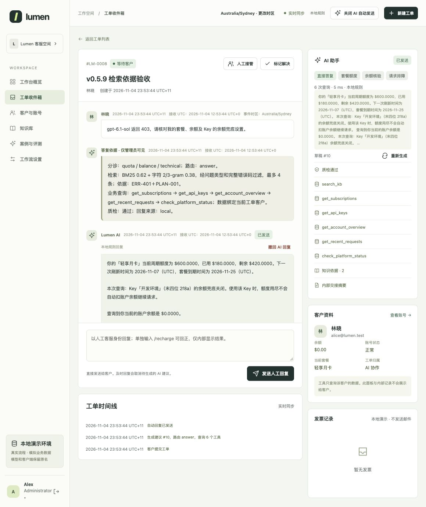
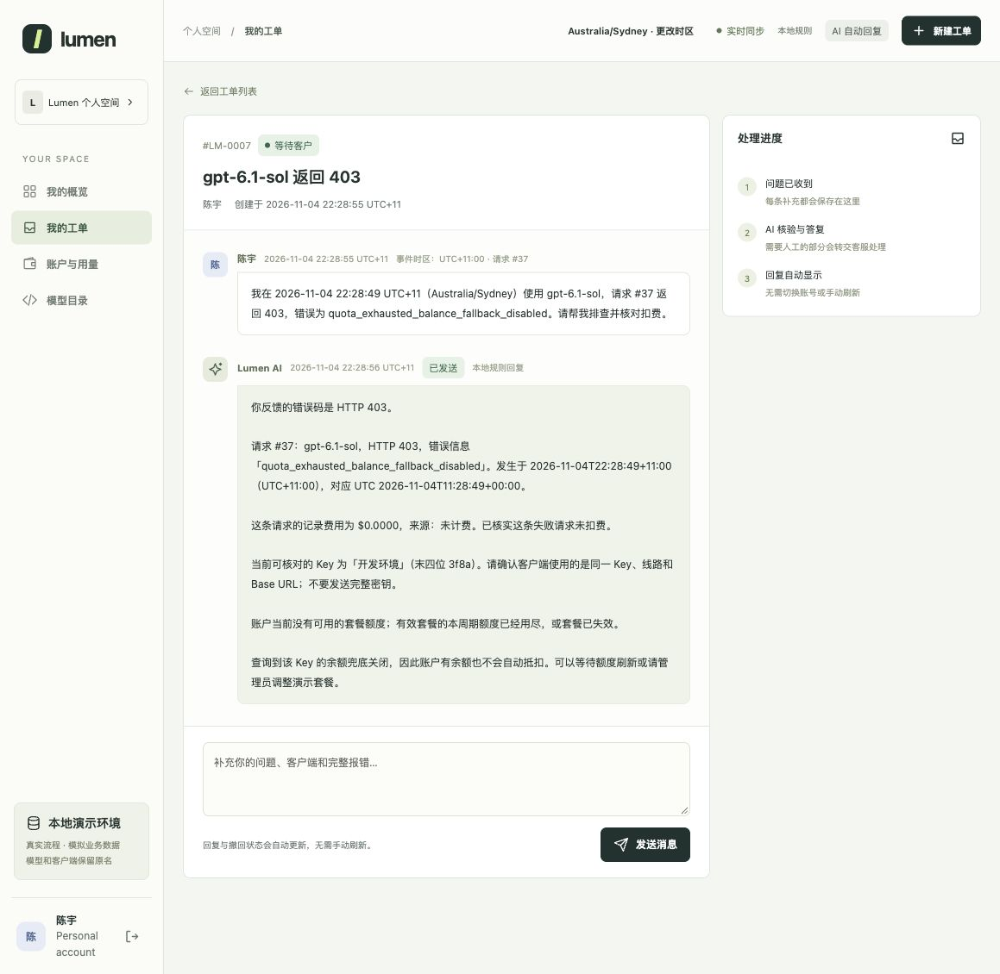

# Release verification

[Documentation](README.md) · [Chinese](verification.zh-CN.md)

## v0.5.10 — real-model acceptance and fixes

Built independently from v0.5.9. Live tests found missing combined knowledge in short Chinese follow-ups, an incorrect fallback for negative monetary amounts, and an ambiguous financial-template source label. Each fix has targeted regression coverage. [Findings and accepted flows](live-model-acceptance.md).

| Check | Result | Evidence |
|---|---|---|
| Software | **292 passed**, Python 3.13 | [Output](../evals/releases/v0.5.10/tests.txt) |
| Portal workflow | **29/29** | [Report](../evals/releases/v0.5.10/desk-workflow.json) |
| Live model | **12 turns, 34 calls**, `gpt-6-astra`, Chat Completions | [Per-turn results](../evals/releases/v0.5.10/live-model.json) |
| Retrieval regression | **17/17 development + 8/8 historical answerable questions fully covered** | [Development](../evals/releases/v0.5.10/retrieval-development.json), [historical diagnostic](../evals/releases/v0.5.10/retrieval-historical.json) |
| Permissions and staff override | Private evidence, personal-view restrictions, one-time correction and repeat-command check | [Permissions](../evals/releases/v0.5.10/role-and-hold-check.json), [override](../evals/releases/v0.5.10/manual-override-confirmation.json) |
| Browser | Human context, 60-second delay, publication/retraction synchronization | [Observations](../evals/releases/v0.5.10/ui-acceptance.json) |

The live report retains pre-fix failures and corrected reruns; it is not a first-pass success rate. API calls completed successfully, but one pre-fix local monetary check still triggered fallback. No provider tariff was supplied. Retrieval cases are already known; Docker and the separate legacy RAG evaluator were not rerun for this release.

## v0.5.9 — reviewed automation and admin evidence

Built independently from v0.5.8. That release implemented automatic eligible corrections, staff `/recharge`, internal result visibility, admin-only evidence receipts, reviewed knowledge filtering and reported usage/cost estimates.

| Check | Result | Evidence |
|---|---|---|
| Software | **283 passed**, Python 3.13 | [Output](../evals/releases/v0.5.9/tests.txt) |
| Portal workflow | **29/29** | [Report](../evals/releases/v0.5.9/desk-workflow.json) |
| Legacy RAG | **48/48 cases, 63/63 turns** | [Report](../evals/releases/v0.5.9/legacy-rag.json) |
| Reviewed label gate | **30 approved, zero pending** | [Report](../evals/releases/v0.5.9/dataset-validation.json) |
| Retrieval | **17/17 development + 8/8 historical diagnostic answerable questions fully covered** | [Development](../evals/releases/v0.5.9/retrieval-development.json), [diagnostic](../evals/releases/v0.5.9/retrieval-holdout-diagnostic.json) |
| Local browser | Automatic reply, internal receipt, 60-second suggestion, send/retract synchronization, admin evidence and pricing form | [Observations](../evals/releases/v0.5.9/ui-acceptance.json) |

The balance workflow fixture now expects the approved automatic operation instead of the superseded manual-approval wording. Old frozen evidence is unchanged. All retrieval cases were already exposed: these are regression diagnostics, not a new blind result.

No real model API or Docker build was run. Structured evidence generation, failure fallback, cost math and role filtering were tested with mocked responses.

## v0.5.8 — approved business rules

Built independently from v0.5.7 on 4 November 2026. Implemented the owner's ten-rule review without overwriting the working project or frozen retrieval assets.

- Added scheduled quota refresh, simulated balance fallback billing and ledger visibility.
- Allowed support-approved balance corrections under the $5 / seven-day rule; retained admin-only arbitrary financial and account changes.
- Added verified-order invoice edits/reissue, revision checks and live customer messages.
- Added account-scoped request-ID lookup, per-message time-zone context and deterministic UTC conversion, including ambiguity checks.
- Reused known diagnostic information; corrected invoice-result follow-ups and preserved human priority, private suggestions and retraction.

| Check | Result | Evidence |
|---|---|---|
| Software suite | **263 passed**, Python 3.13; includes 38 new rule checks | [Full output](../evals/releases/v0.5.8/tests.txt) |
| Portal workflow | **29/29 scenarios**, fixed clock | [Report](../evals/releases/v0.5.8/desk-workflow.json) |
| Legacy RAG | **48/48 scenarios, 63/63 turns**, no regression | [Report](../evals/releases/v0.5.8/legacy-rag.json) |
| Dataset structure | **30 queries / 22 groups**, all labels still pending review | [Report](../evals/releases/v0.5.8/dataset-validation.json) |
| Local browser acceptance | Customer/support/admin controls and live updates verified | [Observations](../evals/releases/v0.5.8/ui-acceptance.json) |

Browser checks covered automatic replies with exact request fees and UTC/local evidence, changing display zones, balance fallback, support-approved correction, invoice title edits, the 60-second private suggestion, send/retract synchronization, and quota refresh visible on the customer page. These are local synthetic-data checks, not a latency SLA or live-model evaluation.

The tests use mocked model responses, including evidence passed to composition and review. **No external model API or Docker build was run for v0.5.8.** Real credentials remain process-only; use the launcher to validate your endpoint.

Current policy knowledge changed. Old retrieval inputs/results remain frozen; their scores are not reused as evidence for the new knowledge. The workflow case with incomplete date information no longer requires a potentially misleading recent-log lookup; its routing and fact checks remain. [Approved rules](business-rules.md).

## v0.5.7 — documentation and packaging

Built independently from the v0.5.6 release ZIP on 4 November 2026. The portal, model integration, knowledge, retrieval implementation and frozen experiment results are unchanged.

Changes:
- Rewrote bilingual quick starts and guides; added local SVG language buttons and linked technology/test badges.
- Separated current portal documentation from legacy RAG and historical release notes.
- Corrected the old baseline-reconstruction command: it now requires a matching historical source snapshot and checks hashes before applying a patch.
- Extended release exclusions for caches, environment files, database sidecars and editor backups; retained required fixtures and audit evidence.

| Check | Result | Evidence |
|---|---|---|
| Software suite | **225 passed**, Python 3.12 | [Full output](../evals/releases/v0.5.7/tests.txt) |
| Portal workflow | **29/29 scenarios** | [Report](../evals/releases/v0.5.7/desk-workflow.json) |
| Legacy RAG | **48/48 scenarios, 63/63 turns**, no baseline regression | [Report](../evals/releases/v0.5.7/legacy-rag.json) |
| Dataset validation | **30 queries / 22 groups**, all pending owner review | [Report](../evals/releases/v0.5.7/dataset-validation.json) |

Seven added checks cover packaging boundaries and historical-source validation. The old implementation itself was not reconstructed: the required historical source is not included.

No external model calls or Docker build were made for this release. Local API tests use simulated responses. The v0.5.6 holdout was not rerun or used to change parameters.

## Historical evidence

| Version | Focus | Record |
|---|---|---|
| v0.5.6 | BM25, character n-gram and hybrid comparison | [Analysis](retrieval-comparison.md), [frozen results](../evals/retrieval/experiments/v0.5.6) |
| v0.5.5 | Independent retrieval dataset and grouped split | [Dataset](retrieval-dataset.md) |
| v0.5.4 | Reproducible workflow and legacy baselines | [Baseline manifest](../evals/baselines/lumen-v0.5.3-2026-11-04/manifest.json) |
| v0.5.3 | Quota, balance and configuration topic switching | [Live-model record](topic-switch-live-v0.5.3.json) |
| v0.5.2 | Follow-ups, refunds and human context | [Live-model record](multiturn-live-v0.5.2.json) |

The [historical verification archive](history/verification-through-v0.5.6.zh-CN.md) is in Chinese and preserves earlier screenshots and observations. Historical live-model success is not a new API verification for this release.

Remaining measurement: new unseen queries and live-model/business outcomes. [Measurement plan](evaluation.md#remaining-measurements).

