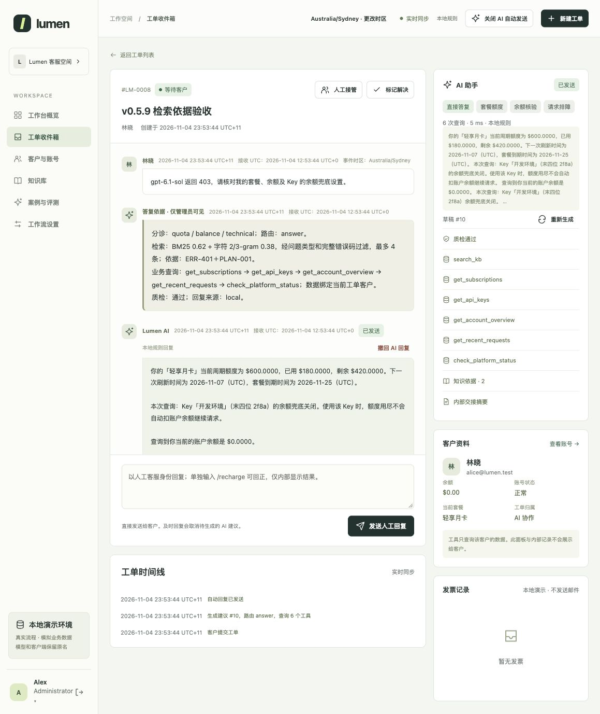
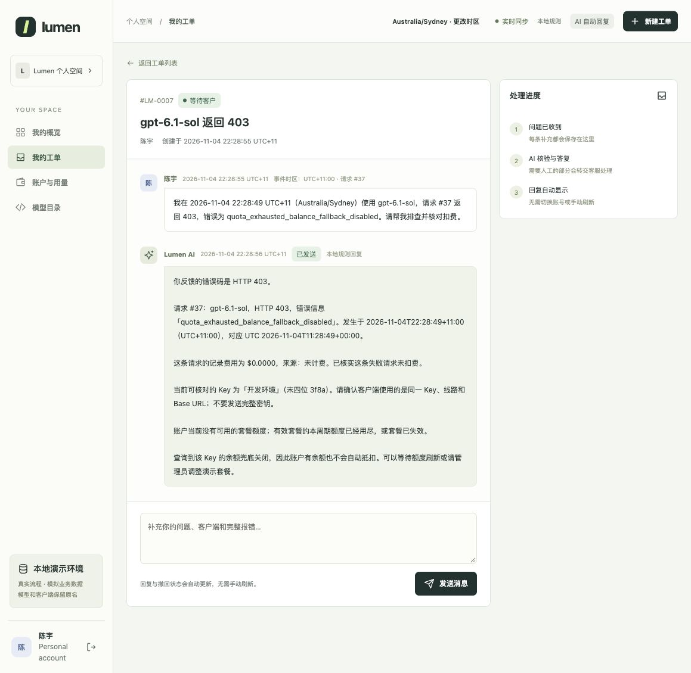

# 版本验证

[文档索引](README.zh-CN.md) · [English](verification.md)

## v0.5.10：真实模型验收与修复

基于 v0.5.9 独立构建。真实测试发现中文短追问遗漏组合知识、负金额误回退，以及财务模板来源标记不清晰；均已修复并增加针对性回归。[发现与验收流程](live-model-acceptance.zh-CN.md)。

| 检查 | 结果 | 证据 |
|---|---|---|
| 软件测试 | Python 3.13 下 **292 项通过** | [输出](../evals/releases/v0.5.10/tests.txt) |
| 网站业务 | **29/29** | [报告](../evals/releases/v0.5.10/desk-workflow.json) |
| 真实模型 | `gpt-6-astra`、Chat Completions，**12 轮、34 次调用** | [逐轮结果](../evals/releases/v0.5.10/live-model.json) |
| 检索回归 | **开发 17/17、历史 8/8 有依据题完整命中** | [开发](../evals/releases/v0.5.10/retrieval-development.json)、[历史诊断](../evals/releases/v0.5.10/retrieval-historical.json) |
| 权限与客服回正 | 私有依据、个人视图限制、单次回正及重复命令检查 | [权限](../evals/releases/v0.5.10/role-and-hold-check.json)、[回正](../evals/releases/v0.5.10/manual-override-confirmation.json) |
| 页面 | 人工上下文、60 秒等待、发送及撤回同步 | [观察记录](../evals/releases/v0.5.10/ui-acceptance.json) |

真实报告保留修复前问题及修复后复测，不将总轮次当成首次通过率。API 调用均成功，但修复前仍有一次本地金额质检误判触发回退。未提供服务商单价。检索题均为已知题；本版未重跑 Docker 或独立旧版 RAG 评测。

## v0.5.9：复核落实与管理员依据

基于 v0.5.8 独立建立，包含合规自动回正、工作人员 `/recharge`、内部结果通知、管理员依据、复核后的知识过滤，以及模型用量 / 费用估算。

| 检查 | 结果 | 证据 |
|---|---|---|
| 软件测试 | Python 3.13 下 **283 项通过** | [输出](../evals/releases/v0.5.9/tests.txt) |
| 网站业务 | **29/29** | [报告](../evals/releases/v0.5.9/desk-workflow.json) |
| 旧版 RAG | **48/48 场景、63/63 轮** | [报告](../evals/releases/v0.5.9/legacy-rag.json) |
| 严格标签校验 | **30 题通过、0 题待复核** | [报告](../evals/releases/v0.5.9/dataset-validation.json) |
| 检索 | **开发 17/17、历史诊断 8/8 有依据题完整命中** | [开发](../evals/releases/v0.5.9/retrieval-development.json)、[诊断](../evals/releases/v0.5.9/retrieval-holdout-diagnostic.json) |
| 本地页面 | 自动回复、私有回执、60 秒草稿、发送 / 撤回同步、管理员依据及单价保存 | [观察记录](../evals/releases/v0.5.9/ui-acceptance.json) |

余额流程用例已由旧人工审批文案改为本次确认的自动执行预期。历史冻结证据保持不变。检索题此前均已看过，本次是回归诊断，不是新的盲测。

未调用真实模型 API，也未构建 Docker。结构化摘要、失败回退、费用计算和角色过滤使用模拟响应测试。

## v0.5.8：已确认业务规则落地

2026-11-04 基于 v0.5.7 独立构建，按共同确认的十条规则实施，不覆盖正在编辑的项目或冻结检索材料。

- 补齐额度定时刷新、余额兜底模拟扣款及账本展示。
- 客服可按 $5 / 7 天分段规则审批回正，任意财务调整和账号管理仍限管理员。
- 新增核验订单后的发票修改 / 重开、版本校验及客户实时消息。
- 请求按账户与编号精确定位，保存每条消息时区，由程序换算 UTC 并检查歧义。
- 复用已有排障信息，修正发票修改后追问仍被重新受理的问题，保留人工优先、内部建议及撤回。

| 检查 | 结果 | 证据 |
|---|---|---|
| 软件测试 | Python 3.13 下 **263 项通过**，含新增 38 项规则检查 | [完整输出](../evals/releases/v0.5.8/tests.txt) |
| 网站业务 | 固定时钟下 **29/29 场景** | [报告](../evals/releases/v0.5.8/desk-workflow.json) |
| 旧版 RAG | **48/48 场景、63/63 轮**，无回归 | [报告](../evals/releases/v0.5.8/legacy-rag.json) |
| 数据结构 | **30 题 / 22 组**，标签仍全部待人工复核 | [报告](../evals/releases/v0.5.8/dataset-validation.json) |
| 浏览器验收 | 客户 / 客服 / 管理员按钮与实时更新已验证 | [观察记录](../evals/releases/v0.5.8/ui-acceptance.json) |

页面实测覆盖：精确请求与单笔费用自动回复、UTC / 本地时间和显示时区切换、余额兜底、客服批准回正、发票抬头修改、60 秒内部建议、发送与撤回同步，以及刷新额度后客户页自动更新。这些是本地合成数据验收，不代表线上延迟保证或真实模型表现。

模型测试使用模拟响应，并检查生成与质检获得的证据。**v0.5.8 未调用外部真实模型，也未构建 Docker。** 真实密钥继续只在运行进程中保留，使用启动器验证自己的接口。

本版更新业务知识，旧检索输入和结果保持冻结，不将旧分数当作新知识的成绩。日期信息不完整的业务用例不再要求查询可能误导的近期日志，路由和事实检查保留。[已确认规则](business-rules.zh-CN.md)。

## v0.5.7：文档与发布整理

2026-11-04 基于 v0.5.6 ZIP 独立构建。网站业务、模型接入、知识、检索实现及冻结实验结果沿用原版。

本次修改：
- 重写中英快速上手与说明，添加本地 SVG 语言按钮及可点击技术 / 测试徽章。
- 将当前网站、早期 RAG 和历史版本记录分开组织。
- 修正历史基线重建入口：明确要求匹配源码，并在打补丁前校验哈希。
- 扩大打包排除规则，过滤缓存、环境文件、数据库附属文件和编辑器备份；保留必要测试数据及审计证据。

| 检查 | 结果 | 证据 |
|---|---|---|
| 软件测试 | Python 3.12 下 **225 项通过** | [完整输出](../evals/releases/v0.5.7/tests.txt) |
| 网站业务 | **29/29 场景** | [报告](../evals/releases/v0.5.7/desk-workflow.json) |
| 旧版 RAG | **48/48 场景、63/63 轮**，无基线回归 | [报告](../evals/releases/v0.5.7/legacy-rag.json) |
| 数据集校验 | **30 题 / 22 组**，标签全部待本人复核 | [报告](../evals/releases/v0.5.7/dataset-validation.json) |

新增 7 项检查覆盖打包边界和历史源码校验。未重建旧实现本身，因为所需历史源码未随包提供。

本轮未发外部模型请求，也未构建 Docker。本地 API 测试使用模拟响应，没有重跑 v0.5.6 保留集或据此调参。

## 历史证据

| 版本 | 重点 | 记录 |
|---|---|---|
| v0.5.6 | 三种检索方法对照 | [分析](retrieval-comparison.zh-CN.md)、[冻结结果](../evals/retrieval/experiments/v0.5.6) |
| v0.5.5 | 独立检索集与分组划分 | [数据集](retrieval-dataset.zh-CN.md) |
| v0.5.4 | 业务与旧版 RAG 基线 | [基线说明](history/evaluation-baseline-v0.5.4.zh-CN.md) |
| v0.5.3 | 套餐、余额、配置主题切换 | [真实模型记录](topic-switch-live-v0.5.3.json) |
| v0.5.2 | 连续追问、退款和人工上下文 | [真实模型记录](multiturn-live-v0.5.2.json) |

[历史验证归档](history/verification-through-v0.5.6.zh-CN.md)保留早期截图和观察。历史真实模型成功不代表本版重新进行了 API 验证。

后续测量为新增未见题和真实模型 / 业务效果，详见[评测说明](evaluation.zh-CN.md)。

